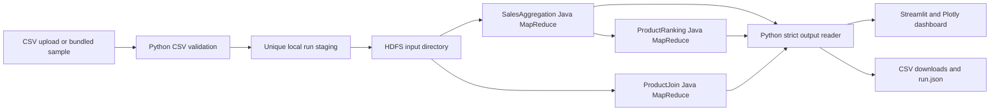

# Architecture

Every execution uses `/bda_sales/runs/<run_id>/input/` and three non-reused HDFS output folders under `output/`. The orchestration invokes `hadoop fs` and `hadoop jar` with argument arrays and timeouts; it does not construct shell command strings. A pipeline is marked successful only when all three jobs return code zero and output schemas parse successfully. Failure persists status and logs and leaves `results` null.

`SalesAggregation` emits PRODUCT, CATEGORY, REGION, MONTH, and TOTAL keys. Reducers sum integer quantities/revenue cents and count distinct encoded order IDs with a set. `ProductRanking` consumes PRODUCT rows and uses one reducer with an inverted fixed-width numeric sort key and product ID tie-break. `ProductJoin` uses tagged transaction/product mapper values keyed by product ID; it emits enriched rows, missing-match status, and profit aggregates when costs are available.

The date/region/category controls filter validated transaction records before the HDFS upload. They do not aggregate metrics in Python. Every chart and KPI after a run uses outputs of the selected input slice's Java jobs.